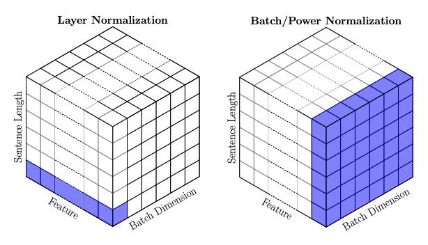
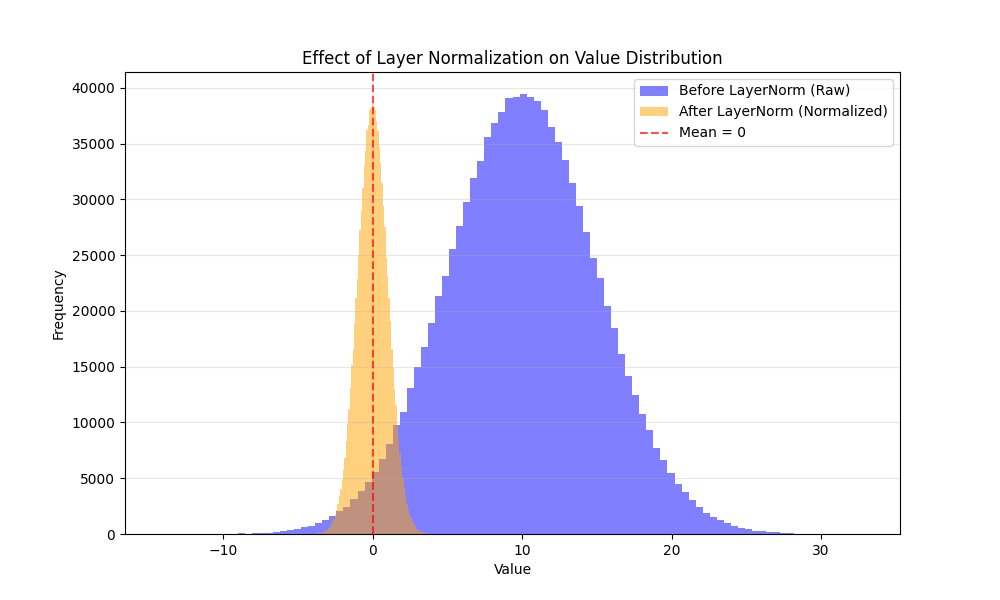


- Paper: <https://arxiv.org/abs/1607.06450>
- Github: <https://github.com/sehyunlee217/paper_implementations/tree/main/layer_norm>

### Issues with BatchNorm that LayerNorm Addresses

LayerNorm addresses a few shortcomings of BatchNorm:

1.  RNNs or any language-based tasks might have different sequences/lengths of data $$\rightarrow$$ We can't simply calculate the statistics across our batches, we also need to **consider the time steps.**
2.  As BatchNorm calculates statistics across the batch for each feature, the **batch sizes need to be relatively large**.
3.  BatchNorm relies on batch statistics during training and stored running statistics at inference. LayerNorm works independently for each sample, which is useful for online learning and small batches.

### Layer Normalization

- LayerNorm computes statistics across the features of each sample, rather than across the batch for each feature.
- Formally, they define the statistics as $$\mu^{l} = \frac{1}{H} \sum^{H}_{i=1} a^{l}_{i}$$ and $$\sigma^{l} = \sqrt{\frac{1}{H} \sum^{H}_{i=1} (a^{l}_{i} -
                    \mu^{l} )^{2}}$$, where $$l$$ stands for the $$l$$th layer, $$a^{l}_{i}$$ as the inputs to the hidden layer, and $$H$$ as the number of hidden units in the layer.
- So we normalize across the hidden units within a layer, giving each sample its own mean and variance.
- I know the wording can be confusing, so here is a quick example. Say the input is $$(32, 3, 64, 64)$$: a batch of 32 images, each with 3 channels and a size of 64 × 64.
- If we perform BatchNorm for this input, we are calculating the statistics for each feature across the batch, so we will calculate $$3$$ statistics as the feature size are the $$3$$ channels for our input and the dimension of the statistics will be $$(1, 3, 1)$$, assuming we flatten the 64 x 64 image to one vector.
- If we perform LayerNorm for this input, we are calculating the statistics for each sample in the batch across all features, so we will instead calculate $$32$$ statistics for our input, and the dimension being $$(32, 1, 1)$$, again assuming we flatten the image.
- This [image](https://proceedings.mlr.press/v119/shen20e/shen20e.pdf) may give a better visualization of how Batch/LayerNorms differ and also an intuitive understanding of why using LayerNorm is the obvious choice for Language modeling.



- First of all, assume that we are conducting BatchNorm across some input of the language. Then, we are essentially normalizing across the batch for a specific feature vector, which is problematic. For example, assume these two sentences are in a batch: 1. **The cat meows.** 2. **The barking dog looks at the cat.**

- If we normalize each position across the batch, the representation of **"cat"** depends on **"barking"** because they occupy the same position. We would prefer to normalize each token independently.

- The sentences also have different lengths, so padding can affect batch statistics unless it is handled carefully. In our example, the shorter sentence has no tokens corresponding to **"looks at the cat"**.

- Therefore, it makes sense to use LayerNorm, where we calculate the statistics across the feature instead of the batches. For our first sentence, **"cat"** will have its own representation and be normalized within its feature space. So assuming that the features space is of size $$512$$, we will calculate some $$\mu$$ and $$\sigma$$ for the word **"cat"** and normalize that feature vector instead.

- This way, each token is normalized independently across its features. Attention handles the context between tokens, while positional encoding provides order.

- I won't mention too much about the internal covariate shifts as it is covered in detail in my BatchNorm post.

### Implementation Details

- The implementation will be pretty straightforward, as it is similar to BatchNorm.

``` py
class LayerNorm(nn.Module):
    def __init__(self, eps=1e-5):
        super().__init__()
        self.eps = eps

    def forward(self, x):
        batch_size, length, feature_dim = x.shape
        output = torch.zeros_like(x)

        for i in range(batch_size):
            for t in range(length):
                word_vector = x[i, t, :]

                mu = word_vector.sum() / feature_dim

                var = ((word_vector - mu) ** 2).sum() / feature_dim

                output[i, t, :] = (word_vector - mu) / torch.sqrt(var + self.eps)

        return output
```

- Here we can try testing out if the layernorm is actually working properly.

``` py
# Assume feature vecs from a batch 32, sentence of length 64, and feature dim. of 512.
# We want to normalize across each word in a batch.
# randn() -> mean 0, variance 1; scaled input has mean 10, variance 25
sample_batch = torch.randn(32, 64, 512) * 5 + 10

print(sample_batch[0, 0, :])

ln_layer = LayerNorm()
out = ln_layer.forward(sample_batch)

print(f"dim(out): {out.shape}") # >>> (32, 64, 512)
print(out[0, 0, :])
```

- Compare `sample_batch[0, 0, :]` before and after normalization. `torch.randn` samples a standard normal distribution; multiplying by 5 and adding 10 gives a mean of 10 and a standard deviation of 5.
- Here we can visually see the effect of LayerNorm on the feature vector for the inputs. Following the example from before, we transformed the feature vector of "cat" to a normalized feature vector.



- We can clean this up with the same PyTorch operations we used for BatchNorm. `keepdim=True` keeps the reduced dimension so the statistics broadcast back over the input. Here is the vectorized version:

``` py
class LayerNorm2(nn.Module):
    def __init__(self, eps=1e-5):
        super().__init__()
        self.eps = eps

    def forward(self, x):
        batch_size, length, feature_dim = x.shape
        output = torch.zeros_like(x)

        # dim=-1 so we squish along last idx(feature_dim)
        # keepdim=True so we get (batch_size, length, 1)
        mu = x.mean(dim=-1, keepdim=True)
        var = x.var(dim=-1, keepdim=True, unbiased=False)

        output = (x - mu) / torch.sqrt(var + self.eps)

        return output
```

